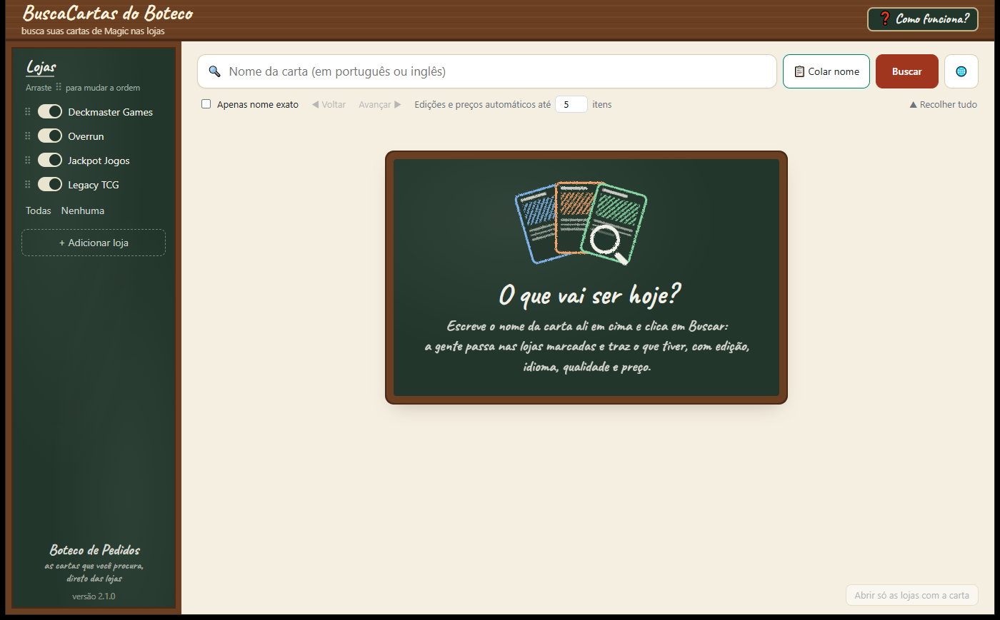
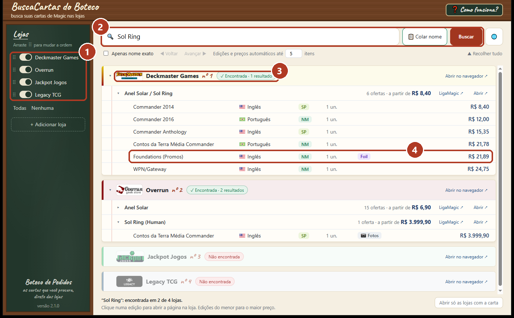
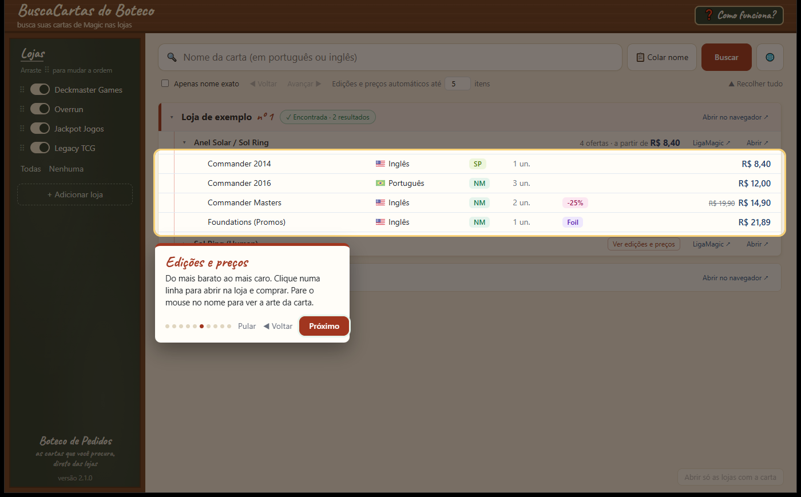
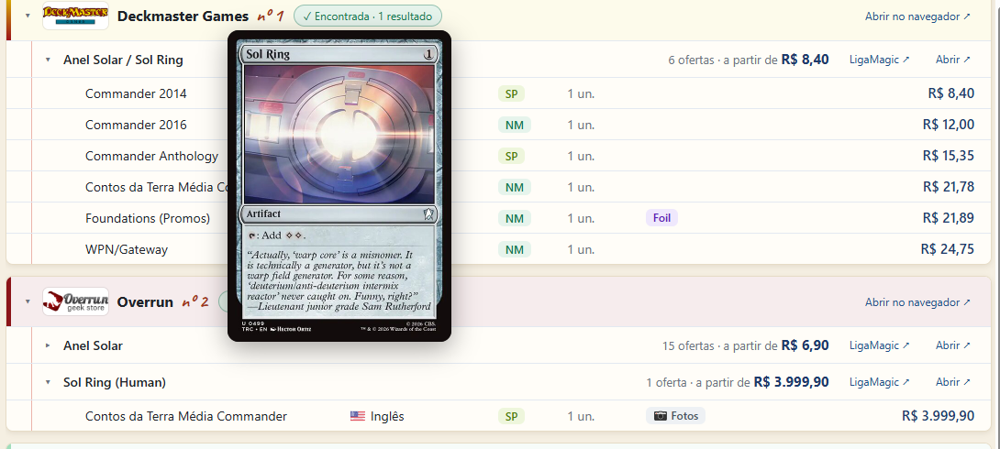

# BuscaCartas do Boteco

Busca cartas de **Magic: The Gathering** em várias lojas de uma vez só.
Você digita o nome da carta e vê em quais lojas tem estoque, com edição, idioma, qualidade e preço.



## Baixar

1. Baixe o **`BuscaCartas.exe`** na página de [versões](https://github.com/vitor-botechi/buscacartas-do-boteco/releases/latest).
2. Abra. Não precisa instalar nada.

Na primeira vez, o Windows pode mostrar "O Windows protegeu o computador". Clique em **Mais informações** e depois em
**Executar assim mesmo**. O aviso aparece porque o programa não tem assinatura digital, que é paga.
Para atualizar, baixe o `.exe` novo. Suas lojas e preferências continuam.

## Como usar



1. **Marque as lojas** em que quer procurar. Para mudar a ordem, arraste pela alça ⠿.
2. **Digite o nome da carta**, em português ou inglês, e clique em **Buscar**.
3. **Veja em quais lojas tem a carta.** As lojas sem a carta ficam mais claras.
4. **Escolha a edição.** Cada linha mostra idioma, qualidade, estoque e preço, do mais barato para o mais caro.
   Clique na linha para abrir a página na loja e comprar por lá.

Na primeira vez, o botão **❓ Como funciona?**, no alto à direita, chama você para um passeio rápido pela tela.
Dá para rever quando quiser.



## O que mais ele faz

- **Arte da carta:** pare o mouse no nome para ver a carta daquela edição.
- **Etiquetas:** Foil, promoção, pré-venda com data de envio, observação da loja e fotos do item.
- **Colar nome:** copiou o nome em outro lugar? Volte para a janela e aperte **Enter** duas vezes: o primeiro cola, o segundo busca.
- **LigaMagic:** o botão **LigaMagic ↗** abre a carta na LigaMagic, no seu navegador, para comparar os preços.
- **Apenas nome exato:** mostra só a carta com aquele nome, em português ou inglês, sem as parecidas.
- **Carregar todos os preços:** quando a loja tem muitos resultados, mostra o menor preço de cada um.
- **Adicionar loja:** cole o link de outra loja que use o mesmo sistema (o da LigaMagic).
- **Voltar e Avançar** entre as buscas, e **Recolher tudo** para ver só o resumo.



### Atalhos

| Atalho | O que faz |
| --- | --- |
| Enter, Enter | Cola o nome copiado e busca |
| Alt+← / Alt+→ | Volta / avança entre as buscas |
| Clique numa edição | Abre a página do produto na loja |

## Respeito às lojas

O programa lê as mesmas páginas que você veria no navegador, com calma: uma busca por loja, e a página de
cada produto só quando você pede (ou sozinho, quando a loja tem poucos itens). Se uma loja pedir para ir
devagar, ele pausa. Não faz varreduras em massa e não compra nada por você.

## Para quem desenvolve

<details>
<summary>Rodar pelo código-fonte, testes e gerar o .exe</summary>

Precisa do [Python 3.10 ou mais novo](https://www.python.org/downloads/). Na pasta do projeto:

```
pip install -r requirements.txt
python buscador_mtg.py
```

Testes (não fazem requisições; usam páginas reais das lojas, sanitizadas, em `tests/fixtures/`):

```
pip install -r requirements-dev.txt
py -m pytest
```

Gerar o `.exe` (sai em `dist/BuscaCartas.exe`):

```
py -m pip install -r instalador/requirements.txt
py instalador/gerar_exe.py
```

- **Código:** pacote `buscador/`. A tela é uma página HTML numa janela do [pywebview](https://pywebview.flowrl.com/) (`buscador/web/`).
  Detalhes em [`CLAUDE.md`](CLAUDE.md) e o roteiro de melhorias em [`docs/ROTEIRO.md`](docs/ROTEIRO.md).
- **Linux e macOS:** pelo código-fonte deve rodar (use `python3`), mas ainda não foi testado. No Linux, o pywebview
  precisa de GTK ou Qt com WebKit.
- **Onde ficam os dados:** `lojas.json`, `config.json` e a pasta `debug/`. No `.exe`, em `%APPDATA%\BuscaCartas`.
  Pelo código-fonte, na pasta do projeto. Nenhum deles vai para o repositório.

</details>

## Aviso

Projeto independente, sem vínculo com as lojas, com a LigaMagic ou com a Wizards of the Coast.
*Magic: The Gathering* é marca da Wizards of the Coast LLC. Os dados mostrados pertencem às respectivas lojas.
Até a versão 1.0.0, o programa se chamava "Buscador de Cartas MTG". O nome atual vem do "Boteco de Pedidos",
o aviso de pedidos da comunidade.

## Licença

[MIT](LICENSE). A letra de giz é a [Caveat](https://github.com/googlefonts/caveat), sob a licença SIL Open Font License
(`buscador/web/pagina/fontes/OFL.txt`).
